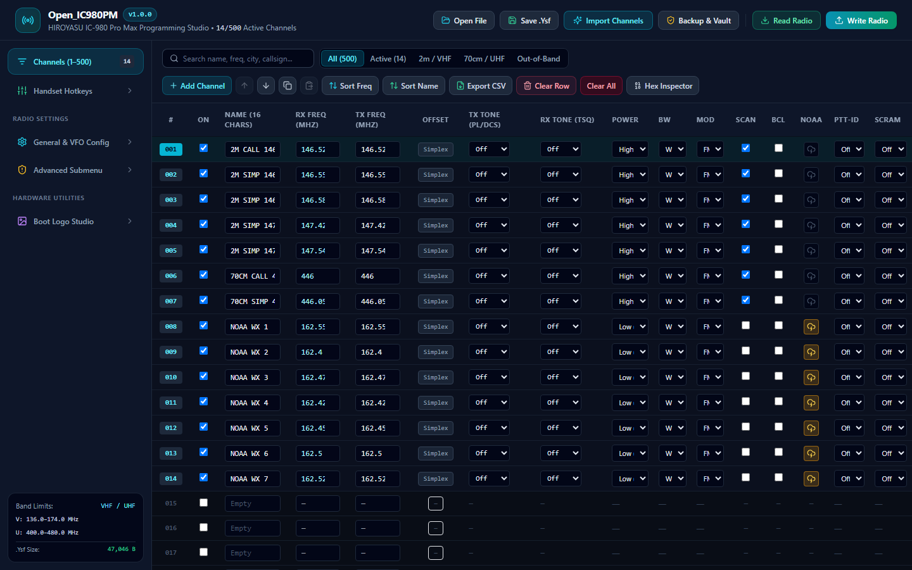
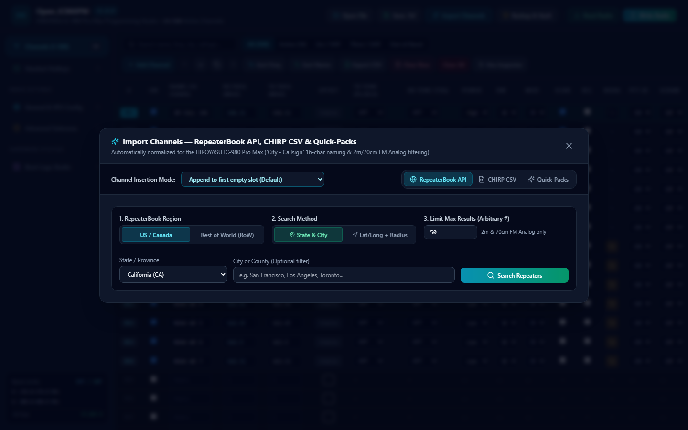
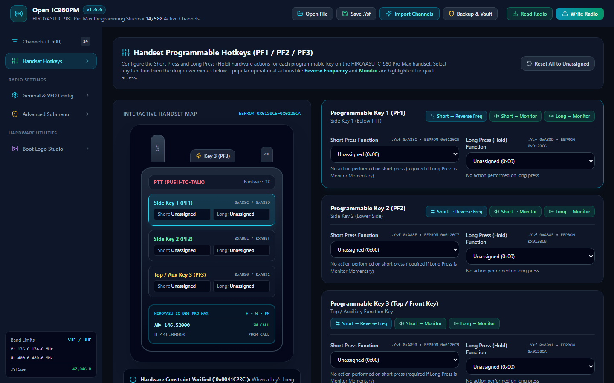
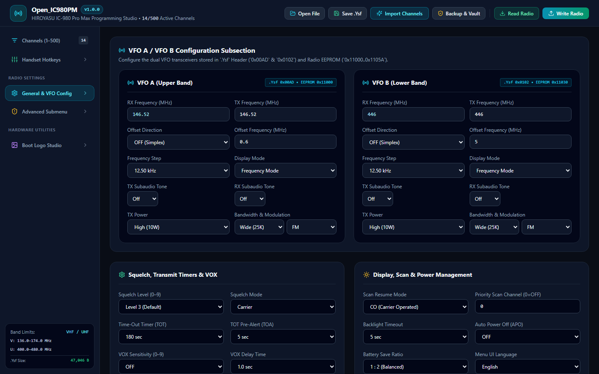
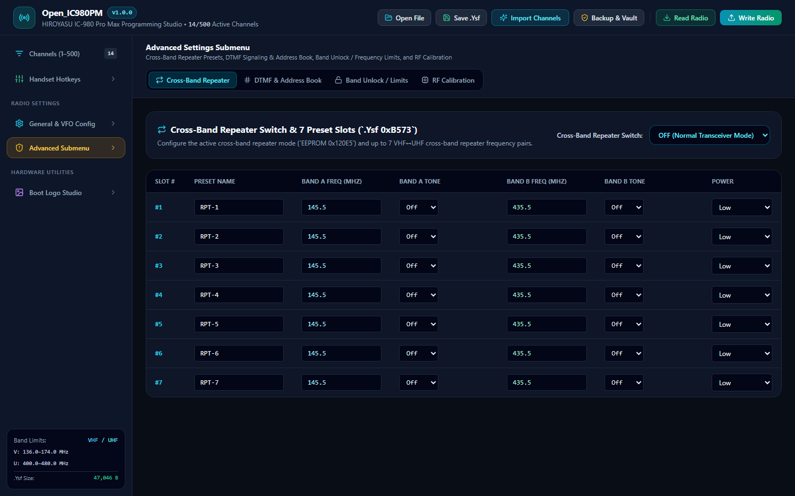
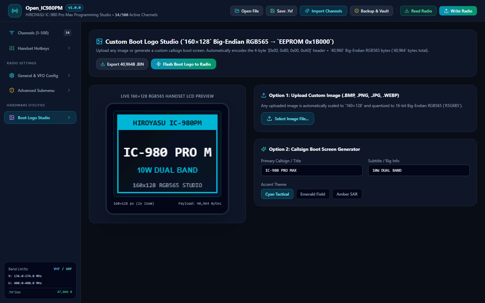

# Open_IC980PM


**Open_IC980PM** (`v1.0.5`) is a clean, modern, cross-platform radio programming studio for the **HIROYASU IC-980 Pro Max** dual-band transceiver. Built from clean-room reverse engineering of the factory Customer Programming Software (CPS), it supports direct **USB HID radio reading and writing** (`ASER _HID` / `ASER-471`), 1:1 lossless **`.Ysf` (`47,046`-byte) codeplug files**, live **RepeaterBook API** imports, **CHIRP CSV** interoperability, interactive **handset hotkey mapping**, and an automated **Rollback Vault** for pre-write EEPROM safety snapshots.

---

## Table of Contents

- [Quick Start Guide](#quick-start-guide)
  - [Prerequisites](#prerequisites)
  - [Installation & Running](#installation--running)
  - [Running as a Desktop App (Electron)](#running-as-a-desktop-app-electron)
  - [Running on Mobile & Android](#running-on-mobile--android)
- [Application Usage Guide](#application-usage-guide)
  - [1. Connecting, Reading & Writing to the Radio](#1-connecting-reading--writing-to-the-radio)
  - [2. 500-Channel Memory Editor](#2-500-channel-memory-editor)
  - [3. Importing Channels (RepeaterBook, CHIRP & Quick-Packs)](#3-importing-channels-repeaterbook-chirp--quick-packs)
  - [4. Handset Programmable Hotkeys (PF1 / PF2 / PF3)](#4-handset-programmable-hotkeys-pf1--pf2--pf3)
  - [5. General Radio Settings & Dual VFO Subsection](#5-general-radio-settings--dual-vfo-subsection)
  - [6. Advanced Settings Submenu](#6-advanced-settings-submenu)
  - [7. Custom Boot Logo Studio](#7-custom-boot-logo-studio)
  - [8. Backup, Restore & Rollback Vault](#8-backup-restore--rollback-vault)
- [Building & Testing](#building--testing)
- [Hardware & Binary Memory Map Reference](#hardware--binary-memory-map-reference)
- [License](#license)

---

## Quick Start Guide

### Prerequisites
- [Node.js](https://nodejs.org/) (`v18.0.0` or higher)
- USB programming cable for the HIROYASU IC-980 Pro Max (standard K-plug / accessory connector)

### Installation & Running

1. **Clone or download the repository:**
   ```bash
   git clone https://github.com/open-ic980pm/open-ic980pm.git
   cd open-ic980pm
   ```

2. **Install dependencies:**
   ```bash
   npm install
   ```

3. **Start the local Web / WebHID development server:**
   ```bash
   npm run dev
   ```
   Open `http://localhost:5173` in any Chromium browser (Google Chrome, Microsoft Edge, Brave, or Opera). Chromium browsers support the **WebHID API**, enabling direct USB communication with the radio without installing specialized serial drivers.

### Running as a Desktop App (Electron)

To launch Open_IC980PM as a standalone native desktop window on Windows, macOS, or Linux:
```bash
npm run electron:dev
```

### Running on Mobile & Android

- **PWA Mode (Instant):** Run `npm run dev -- --host` on your computer, navigate to your computer's local IP address from your Android phone's browser (e.g. `http://192.168.1.50:5173`), and select **Add to Home screen**. You can edit codeplugs, perform live GPS-based RepeaterBook searches, and save `.Ysf` files to your phone.
- **Direct USB OTG Programming from Android:** Open_IC980PM can be compiled with Capacitor (`npx cap add android`) to grant USB Host permissions (`android.hardware.usb.host`) and program the radio directly through a USB-C OTG cable adapter.

---

## Application Usage Guide

### 1. Connecting, Reading & Writing to the Radio



1. **Connect the Cable:** Firmly plug the programming cable into the handset/microphone jack of the HIROYASU IC-980 Pro Max and connect the USB end to your PC or Android OTG port.
2. **Power On:** Turn the radio power switch **ON**. Ensure the radio is idle on the home screen (not transmitting).
3. **Read From Radio:**
   - Click the green **Read Radio** button in the top navigation bar.
   - The connection modal will appear. If the radio has a programming password configured, enter the 6 digits (or leave blank if unlocked).
   - Check **Include 775-Byte RF Calibration Backup** to preserve factory hardware squelch, APC power curves, and VCO tuning parameters.
   - Click **Start Radio Read**. A real-time progress bar will track the `PROG81LS` handshake, sector reads (`0x00000..0x151FD`), and calibration extraction.
4. **Write To Radio:**
   - Click the cyan **Write Radio** button.
   - **Automatic Pre-Write Rollback Vault:** Before any byte is sent to the radio, Open_IC980PM automatically saves a full snapshot of your current codeplug to the local Rollback Vault. If anything is interrupted, you can restore your radio with one click.
   - Click **Start Radio Write**. Upon completion, the radio will emit a reboot beep and load your new configuration.

---

### 2. 500-Channel Memory Editor

The main view provides a high-density, responsive 500-channel grid designed for rapid programming:

- **Clean Default State:** Open_IC980PM starts with **0 placeholder channels**—no pre-loaded test data.
- **Inline Editing:** Click directly on any cell to edit:
  - **RX & TX Frequency (MHz):** Enter frequencies with up to 5 decimal places. The application automatically calculates and displays the repeater shift badge (`Simplex`, `+0.600 MHz`, `-5.000 MHz`, `Split`).
  - **Subaudio Signaling:** Independent RX and TX tone selectors supporting standard **50 CTCSS tones** (`67.0–254.1 Hz`), **104 DCS Normal (`DCS-N`)** codes, and **104 DCS Inverted (`DCS-I`)** codes.
  - **Power Level:** Toggle between `Low`, `Mid`, and `High`.
  - **Bandwidth & Modulation:** Switch between `Wide (25 kHz)` / `Narrow (12.5 kHz)` and `FM` / `AM` modulation.
  - **Hardware Flags:** Toggle `Scan Add`, Busy Channel Lockout (`BCL`), `PTT-ID` (`Off`, `BOT`, `EOT`, `BOTH`), Voice Scrambler (`Off`, `1..8`), and the hardware **NOAA Weather Alert bit** (`Byte 59 Bit 4 = 0x10`).
- **Batch Actions & Reordering:**
  - **Add Channel:** Activates the next available empty slot.
  - **Move Up / Down:** Reorder channels while preserving channel properties.
  - **Copy & Paste:** Duplicate channel configurations across rows.
  - **Sort Freq / Name:** Alphabetize or sort active channels by frequency in one click.
  - **Export CSV:** Export all active channels directly to a standard CHIRP-compatible CSV.
- **Binary Record Inspector:** Click the **Hex Inspector** button to open a live drawer displaying both the 85-byte `.Ysf` file record and the 34-byte Radio EEPROM record (`0x1000 + ((ch / 32) << 12) + (ch % 32) * 34`) for the selected channel, including an editor for **8-Digit Custom Hex Subaudio** (`Byte 58 Bit 6 = 0x40`).

---

### 3. Importing Channels (RepeaterBook, CHIRP & Quick-Packs)



Click **Import Channels** in the top navigation bar to open the unified import studio:

#### A. RepeaterBook Live API Importer
- **Region Selector:** Toggle between **US / Canada** (`export.php`) and **Rest of World (RoW)** (`exportROW.php`).
- **Search Method:**
  - **State & City:** Select your state or province from the dropdown and optionally type a city or county name.
  - **Lat/Long + Radius:** Enter your latitude, longitude, and radius in miles or kilometers (computes precise distances using the Haversine formula).
- **Arbitrary Result Limit:** Enter an arbitrary maximum number of results to fetch (`Max Results`).
- **Automatic 2m / 70cm FM Analog Filter:** RepeaterBook results are automatically filtered to analog repeaters operating in the amateur **2-meter (`144–148 MHz`)** and **70-centimeter (`420–450 MHz`)** bands.
- **Clean Channel Naming:** Channel names are automatically formatted as **`City - Callsign`** (e.g., `San Franc - W6PW`), cleanly truncated to fit the radio's 16-character alphanumeric limit without clipping callsigns.

#### B. CHIRP & CPS CSV Importer
- Load any `.csv` file saved from CHIRP or the factory software, or paste raw CSV text directly into the text area.
- Automatically maps frequencies, duplex shift, CTCSS tones, DCS codes, and channel names.

#### C. Built-in Quick-Packs
One-click import of curated channel sets:
- **NOAA Weather (WX 1–7):** All 7 NOAA frequencies (`162.400–162.550 MHz`) with the IC-980 Pro Max hardware NOAA alert bit enabled.
- **2m / 70cm Ham Calling:** National FM Simplex calling frequencies (`146.520`, `146.550`, `146.580`, `446.000 MHz`).
- **GMRS (Ch 1–22 + 8 Repeaters):** Standard simplex channels and repeater pairs with +5.0 MHz shift.
- **FRS (Ch 1–22):** Standard UHF Family Radio Service channels.
- **VHF Marine:** Distress (`Ch 16`), bridge-to-bridge (`Ch 13`), and intership channels.

#### D. Flexible Channel Insertion Modes
Use the top dropdown to control how imported channels are placed into the 500-channel list:
- **Append to first empty slot (Default):** Preserves all existing channels and fills available gaps.
- **Insert at selected channel:** Shifts existing channels down to make room.
- **Overwrite starting at selected channel:** Replaces channels consecutively starting at your chosen row.

---

### 4. Handset Controls & Firmware Hotkeys



#### Physical Hand Mic (HM-18) Layout
- **Left Side:** Large orange rubber Push-To-Talk (**PTT**) paddle.
- **Top Edge:** **Button A** (switches to Main Band / VFO A) and **Button B** (switches to Sub Band / VFO B).
- **Front Panel:** Standard 16-key DTMF keypad (`0–9`, `*`, `#`, `FUN`, `▲`, `▼`, `EXIT`) and dual RX/TX status LEDs.
- **`FUN` Shortcut Combinations:** Quick operational actions are triggered via `FUN + [0–9]` (e.g. `FUN + 7` for FM Broadcast Radio, `FUN + 9` for Scanning, `FUN + 2` for Power Level, `FUN + 1` for Squelch, `FUN + 0` to Save Memory Channel).

#### Firmware Codeplug Registers (`Key 1`, `Key 2`, `Key 3`)
- **PF1 / Key 1** (`.Ysf 0xA88C / 0xA88D` ↔ `EEPROM 0x0120C5 / 0x0120C6`)
- **PF2 / Key 2** (`.Ysf 0xA88E / 0xA88F` ↔ `EEPROM 0x0120C7 / 0x0120C8`)
- **PF3 / Key 3** (`.Ysf 0xA890 / 0xA891` ↔ `EEPROM 0x0120C9 / 0x0120CA`)
- *Platform Architecture Note:* These 3 function registers are inherited from the factory 8118/PROG81LS shared MCU firmware platform. While the physical HM-18 mobile mic does not route auxiliary side keys, the registers are preserved in Open_IC980PM for 100% bit-exact codeplug and EEPROM fidelity with the factory CPS.
- **Hardware Mutual-Exclusion Rule (`0x0041C23C`):** When Long Press is assigned to `Monitor Momentary` (`0x02`), the radio firmware requires Short Press on that key to remain `Unassigned` (`0x00`) so the squelch opens instantly upon pressing. Open_IC980PM enforces this rule automatically.

---

### 5. General Radio Settings & Dual VFO Subsection



Navigate to **General & VFO Config** in the sidebar:

- **Integrated VFO A & VFO B Subsection:** Full configuration of VFO A (upper band, stored at `.Ysf 0x00AD` / `EEPROM 0x11000`) and VFO B (lower band, stored at `.Ysf 0x0102` / `EEPROM 0x11030`), including RX/TX frequencies, repeater offset shift & frequency, tuning step (`2.50 kHz`–`50.00 kHz`), subaudio tones, power, bandwidth, and display mode.
- **Squelch, Timers & VOX:** Squelch level (`0–9`), squelch mode (`Carrier`, `CTCSS/DCS`, `Carrier+CTCSS`), Time-Out Timer (`OFF` to `360s`), Time-Out Alert (`OFF` to `10s`), VOX level (`1–9`), VOX delay (`0.5s`–`2.0s`), 1750 Hz burst tone, and subaudio tail elimination.
- **Display, Scan & Power:** Dual watch toggle, scan resume mode (`TO`, `CO`, `SE`), priority scan channel, backlight duration, auto power off (`OFF` to `180 min`), battery save ratio (`1:1` to `1:8`), keypad lock, menu language, and standby/TX/RX LED color customization.
- **Welcome Message, Callsign & Password:** Power-on display mode (`Welcome Picture`, `Welcome Message`, `Battery Voltage`), Line 1 message (16 chars), Line 2 message (20 chars), Radio Callsign (`eHuHao`, 14 chars), and a 6-digit programming password encrypted via the radio's proprietary 10×6 permutation matrix (`EEPROM 0x16000`).

---

### 6. Advanced Settings Submenu



Click **Advanced Submenu** in the sidebar to access hardware-level controls:

1. **Cross-Band Repeater Presets (`.Ysf 0xB573`):** Configure the master cross-band repeater switch (`OFF` or `Slot 1..7`) and edit all 7 VHF↔UHF repeater preset pairs, including Band A & B frequencies, subaudio tones, and transmit power.
2. **DTMF Signaling & Address Book (`.Ysf 0xB32D`):** Configure side-tone timing, tone duration, inter-digit delay, local DTMF ID, remote stun code (`0x1208F`), kill code (`0x120A0`), revive code (`0x120B1`), 15 DTMF memory groups, and 15 alphanumeric address book contacts.
3. **Hardware Band Limits & Band Unlock (`.Ysf 0xB786`):** Adjust the minimum and maximum VHF (`136–174 MHz`) and UHF (`400–480 MHz` or extended `400–520 MHz`) frequency limits written to `EEPROM 0x12006..0x12015`. A live Out-of-Band Channel Validator flags any memory channels that fall outside your selected limits.
4. **RF Calibration Inspector (`EEPROM 0x18000`):** View the 775-byte hardware RF calibration block in hex, and export or import standalone `.cal` binary backup files.

---

### 7. Custom Boot Logo Studio



Open the **Boot Logo Studio** to customize the startup image displayed on the radio's 160×128 color LCD:

- **Image Upload:** Upload any `.png`, `.jpg`, `.bmp`, or `.webp` image. The studio automatically scales the image to `160×128` pixels and quantizes colors to 16-bit Big-Endian RGB565 (`R5G6B5`).
- **Callsign Generator:** Enter your amateur callsign and rig subtitle to generate a sharp, technical boot screen with selectable color accents (Cyan Tactical, Emerald Field, Amber SAR).
- **Direct Flashing:** Click **Flash Boot Logo to Radio** to write the 40,964-byte payload directly to EEPROM address `0x1B000` over USB HID / WebHID.
- **Export:** Save the raw `.bin` payload to your computer for archiving.

---

### 8. Backup, Restore & Rollback Vault

Click **Backup & Vault** in the top navigation bar:

- **Export `.Ysf` File:** Saves a pristine `47,046`-byte binary file 100% compatible with the official factory software.
- **Export `.ic980.json` Bundle:** Saves a rich JSON configuration containing the full binary codeplug plus RepeaterBook metadata (city, callsign, distance, notes) and RF calibration.
- **Restore from File:** Load either a `.Ysf` binary or a `.ic980.json` bundle.
- **Rollback Vault:** Inspect past pre-write safety snapshots and restore your radio to any previous state with a single click.

---

## Building & Testing

### Running the Test Suite
The project uses [Vitest](https://vitest.dev/) to verify all binary codecs, EEPROM address calculations, password cipher algorithms, USB HID packet framers, and import pipelines:
```bash
npm test
```

### Production Build
Compile TypeScript and bundle the frontend into `dist/`:
```bash
npm run build
```

### Compile Electron Desktop Scripts
```bash
npm run electron:compile
```

---

## Hardware & Binary Memory Map Reference

| Region / Parameter | `.Ysf` File Offset | Radio EEPROM Address | Size | Description |
| :--- | :--- | :--- | :--- | :--- |
| **Write Timestamp** | `0x0000` | `0x012000` | 6 B | `[Year_hi, Year_lo, Month, Day, Hour, Min]` |
| **VFO A Record** | `0x00AD` | `0x011000` | 85 B | VFO A RX/TX Hz, tones, power, BW, modulation |
| **VFO B Record** | `0x0102` | `0x011030` | 85 B | VFO B RX/TX Hz, tones, power, BW, modulation |
| **Channel Used Bitmask** | `0x015F` | `0x000000` | 63 B | Active channel bitmask for channels 1..500 |
| **500 Channels** | `0x0234` | Banked (`0x01000..`) | 42,500 B | 500 × 85B records (EEPROM: 34B/ch banked) |
| **Key 1 Short Press** | `0xA88C` | `0x0120C5` | 1 B | Handset PF1 short press action byte |
| **Key 1 Long Press** | `0xA88D` | `0x0120C6` | 1 B | Handset PF1 long press action byte |
| **Key 2 Short Press** | `0xA88E` | `0x0120C7` | 1 B | Handset PF2 short press action byte |
| **Key 2 Long Press** | `0xA88F` | `0x0120C8` | 1 B | Handset PF2 long press action byte |
| **Key 3 Short Press** | `0xA890` | `0x0120C9` | 1 B | Handset PF3 short press action byte |
| **Key 3 Long Press** | `0xA891` | `0x0120CA` | 1 B | Handset PF3 long press action byte |
| **DTMF Address Book** | `0xB32D` | `0x015000` | 510 B | 15 PTT-ID memory groups + 15 contacts |
| **Cross-Band Presets** | `0xB573` | — | 168 B | 7 cross-band repeater preset slots (24B each) |
| **Band Limits** | `0xB786` | `0x012006` | 64 B | VHF / UHF frequency limits (`V_min`, `V_max`, etc.) |
| **Password Block** | `0x0060` | `0x016000` | 16 B | Encrypted 6-digit programming password |
| **RF Calibration** | — | `0x018000` | 775 B | Hardware squelch, APC, and tuning calibration |
| **Boot Logo Screen** | — | `0x01B000` | 40,964 B | 4B dimensions header + 160×128 Big-Endian RGB565 |

---

## License

This project is licensed under the [MIT License](LICENSE).
